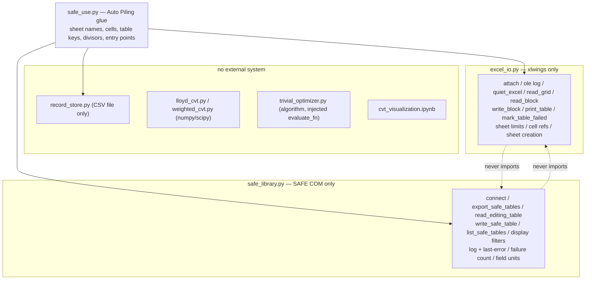

# Refactor plan: separate Excel-facing, SAFE-facing and model code

Status: **plan only — no implementation has started.**
Written: 2026-10-11. Revised: 2026-10-17 against the tree after the margin,
mass-density and demo-script work (`cf38e5f`, `e33eef7`, `c8b131b`).
Owner: user. Workspace: `c:\dev\csi_safe_automation`.

This document is written to be worked **step by step by several agents**. Read
§1 and §14 before touching anything, then take one work package from §8 at a
time. Each work package has its own goal, deliverables, acceptance criteria and
verification command. Do not start a work package whose dependencies are not
green.

---

## 1. How to use this document

1. Read §5 (current state) and §6 (target) in full before your first edit.
2. Pick the lowest-numbered work package in §8 whose dependencies are all
   `done` in the status board (§2).
3. Work **only** inside that work package's file list. If you need a change
   outside it, stop and record why in the status board instead of making it.
4. Run that work package's verification command(s) and paste the result in the
   status board row (or in your commit message if you cannot edit the board).
5. Update the status board (§2) and append a short section to the workspace
   memory file (`/memories/repo/csi-safe-automation.md`) describing what
   changed, how it was verified, and anything you learned the hard way.
6. Do not re-open anything in §13. Those observations were reviewed and
   deliberately deferred by the owner.

Non-negotiables carried over from the repository's existing conventions:

- Every module is fully type-annotated and must be free of Pylance errors.
- Module docstrings state what the module is for and who it talks to.
- Tests live in `tests/`, are self-running (no pytest import), and never touch
  a real records CSV under `data/` — temp copies only. The live path today is
  `data/SWTKT_test_records_2026-10-12.csv` (the optimizer's `RECORDS_CSV`).
- Python for anything that needs `xlwings`: `c:\Python314\python.exe`
  (3.14.4, xlwings 0.37.4). Secondary: `C:\ProgramData\anaconda3\python.exe`
  (3.9, xlwings 0.29.1). There is no venv, no `requirements.txt` and no
  `.vscode/settings.json` in this repo.

---

## 2. Status board

Agents: keep this table current. `status` is one of `todo`, `in-progress`,
`blocked`, `done`. Add a row note with the evidence (command + result).

| WP | Title | Depends on | Status | Notes |
| -- | ----- | ---------- | ------ | ----- |
| WP-0 | SAFE backend probe (pythonnet vs pywin32) | — | todo | blocks WP-3 |
| WP-1 | Extract `excel_io.py` from `auto_analysis.py` | — | todo | pure move, no SAFE needed |
| WP-2 | Import-boundary test | WP-1 | todo | grows as modules appear |
| WP-3a | `safe_library.py`: log, errors, connect, read | WP-0 | todo | |
| WP-3b | `safe_library.py`: write, listing, filters, counters | WP-3a | todo | |
| WP-4a | `safe_use.py`: Excel sheet contracts of the model | WP-1, WP-2 | todo | |
| WP-4b | `safe_use.py`: SAFE workflows via `safe_library` | WP-3b, WP-4a | todo | |
| WP-5 | Retarget `trivial_optimizer.py`; move glue to `safe_use` | WP-4b | todo | |
| WP-6 | Retire `auto_analysis.py`; update README; mark `.bas` superseded | WP-5 | todo | |
| WP-7 | End-to-end verification against real Excel + SAFE | WP-6 | todo | owner-supervised, manual |

Re-verified 2026-10-17: still no `excel_io.py`, `safe_library.py` or
`safe_use.py` in the tree, so every work package remains `todo`. The line
anchors, file sizes and work-package steps below were re-derived from the
current tree on that date.

---

## 3. Decisions register

Each decision has a **default** that agents may implement without asking. If
the owner overrides a decision, that is a plan change: update this table and the
affected work package before continuing.

| ID | Decision | Default (implement this) | Alternative | Affects |
| -- | -------- | ------------------------ | ----------- | ------- |
| D1 | Where generic Excel code lives | New module `excel_io.py` | Keep it inside `safe_use.py` (the earlier instruction's literal reading) | WP-1, WP-2, WP-4a |
| D2 | Fate of `auto_analysis.py` | Delete it after WP-5 | Keep a thin deprecated re-export facade | WP-6 |
| D3 | SAFE backend | Decide with WP-0 probe; **pythonnet + `SAFEv1.dll` is the default candidate** (the reference script proves it, arrays come back as tuples) | `pywin32` + `win32com.client.gencache.EnsureDispatch` on `CSI.SAFE.API.ETABSObject` (no hardcoded DLL path) | WP-3a, WP-3b |
| D4 | Interpreter for the SAFE path | `c:\Python314\python.exe` if the chosen backend supports it; else anaconda 3.9 | install a dedicated interpreter | WP-0, WP-3a |
| D5 | Message boxes | Log-only. Keep a module flag `MSG_BOX_LOGGING = False`; a `ctypes.windll.user32.MessageBoxW` path is optional and off | no flag at all | WP-4b |
| D6 | The `.bas` modules | Keep in the tree as the reference implementation; mark superseded in `README.md` only after WP-7 passes. Never delete | delete immediately | WP-6 |
| D7 | SAFE write-back of numbers | One shared `num_to_text()` (decimal point forced, up to 12 decimals, no scientific notation) used by every path that writes a number into a SAFE table | per-call formatting | WP-4b |

---

## 4. Goals and non-goals

**Goals**

1. No module in the repository touches both Excel and SAFE.
2. Excel is reached only through `xlwings`, and only from `excel_io.py`.
3. SAFE is reached only through one module (`safe_library.py`), which never
   touches Excel.
4. Model-specific knowledge (sheet names, cells, table keys, divisors,
   tolerances, record-CSV path) lives in exactly one module (`safe_use.py`).
5. The pure modules (`record_store.py`, `trivial_optimizer.py`, `lloyd_cvt.py`,
   `weighted_cvt.py`, `cvt_visualization.ipynb`) import neither xlwings nor any
   SAFE binding, and stay testable headless.
6. The existing engineering behaviour is preserved exactly — see §11.

**Non-goals**

- Rewriting the algorithms. `lloyd_cvt.py` and `weighted_cvt.py` are untouched.
- Rewriting `record_store.py`. It is already boundary-clean (stdlib `csv` only).
- `Interpolation2D.bas` (1,397 lines, standalone interpolation). Out of scope.
- Changing the workbook's layout, formulas or model. The port must fit the
  workbook, not the other way round.

---

## 5. Current state (verified 2026-10-17)

### 5.1 File sizes

| File | Lines | Boundary status |
| ---- | ----: | --------------- |
| `auto_analysis.py` | 444 | Excel + Excel→SAFE macros + model sheets, all in one module |
| `SAFE_Library.bas` | 2,923 | SAFE API + the generic Excel table writer, mixed |
| `SAFE_Use.bas` | 1,513 | model workflows + Excel range reads/writes, mixed |
| `Interpolation2D.bas` | 1,397 | out of scope |
| `trivial_optimizer.py` | 242 | algorithm is clean; `import auto_analysis as aa` at line 45 pulls in xlwings |
| `record_store.py` | 302 | clean (stdlib `csv` only) |
| `lloyd_cvt.py` | 306 | clean (numpy) |
| `weighted_cvt.py` | 1,034 | clean (numpy/scipy); area and mass-density CVT |
| `cvt_visualization.ipynb` | 628 | clean (imports `weighted_cvt` only) |
| `demo_load_rows.py` | 85 | demo of recorded layouts; imports `auto_analysis` (model glue) |
| `mass_weighted_cvt_plan.md` | 234 | design record for the density work; no code |
| `README.md` | 391 | documents the modules above; must be rewritten |

### 5.2 `auto_analysis.py` — exact inventory (line anchors verified 2026-10-17)

| Lines | Symbol | Category |
| ----- | ------ | -------- |
| 31 | `WORKBOOK` | Excel config |
| 33 | `_wb` | Excel session cache |
| 34 | `_n_coords` | **hidden process state** coupling `write_coords` → `get_utilization` |
| 40, 46 | `_stamp`, `_ole` | Excel/OLE call logging (generic) |
| 69 | `_book` | Excel attach (generic) |
| 97 | `_run_macro` | **Excel→SAFE bridge** (runs the workbook's VBA) |
| 113, 128, 137 | `_number`, `_grid`, `_cell` | Excel value/shape helpers (generic) |
| 142 | `_pile_prefixes` | model sheet contract (`Pile Coords`!A3 down) |
| 159 | `_write_coords_range` | model sheet contract + Excel write |
| 166 | `_utilization` | model sheet contract (`Pile Coords`!H:J) |
| 178 | `write_coords` | model operation (write B3:C, then run `SAFE_Use.ApplyPileCoordinates1`) |
| 201–336 | `init_pile_layout` | model operation (weighted CVT → sheet → SAFE; margin and mass-density pass-through) |
| 338 | `run_analysis` | Excel→SAFE bridge (`SAFE_Use.RunAnalysis1`) |
| 345 | `write_reactions` | Excel→SAFE bridge (`SAFE_Use.WriteNodalReactions1`) |
| 352 | `get_utilization` | model read, gated by `_n_coords` |
| 365 | `read_pile_values` | model read (A + B:C + H:J in one OLE block) |
| 397 | `print_vba_log` | bridge to the VBA log (`SAFE_Library.GetLog`) |
| 422 | `quiet_excel` | Excel quiet mode (generic); ends at 444 |

### 5.3 `trivial_optimizer.py` — the leak

| Lines | Content | Category |
| ----- | ------- | -------- |
| 45 | `import auto_analysis as aa` | **the leak** — importing the algorithm requires xlwings |
| 53 | `RECORDS_CSV: Path = Path(__file__).resolve().parent / "data" / "SWTKT_test_records_2026-10-12.csv"` (line 52 keeps the old literal commented out) | model glue (the run-records log path) |
| 56, 58 | `STEP_SIZE`, `DIRECTIONS` | algorithm parameters (already keyword arguments of `optimize`) |
| 70 | `evaluate` | **model glue**: `aa.write_coords` → `aa.run_analysis` → `aa.write_reactions` → `aa.read_pile_values` → `RecordStore.load(RECORDS_CSV).append(...)` |
| 92–136 | `governing`, `peak`, `move_pile`, `NoImprovementError` | clean algorithm |
| 138 | `optimize(*, store=None, ..., evaluate_fn=evaluate, ...)` | clean, except the `evaluate_fn` default; `store=None` loads `RECORDS_CSV` |
| 197 | `main` | model glue: builds `CAP_POLYGON`, `PILE_WEIGHTS`, `N_PILES` and `MARGIN=3500`, calls `aa.init_pile_layout(...)`, seeds an empty store with that layout, then optimizes inside `aa.quiet_excel()` |

Its own docstring already claims "all model-specific knowledge is confined to
the model glue block". After this refactor that claim becomes true of the
*module*: the glue moves to `safe_use.py`.

### 5.4 Boundaries that already hold

- `record_store.py` imports only `csv`, `pathlib`, `typing`. It has **no**
  default CSV path by design (`load(path)` requires it) — keep that.
- `lloyd_cvt.py`, `weighted_cvt.py` import only numpy/scipy.
- `cvt_visualization.ipynb` imports `weighted_cvt` and uses `matplotlib`.
- Only `auto_analysis.py` line 29 imports `xlwings`.
- `demo_load_rows.py` imports `auto_analysis` at line 22; it is the second
  module that has to be retargeted before WP-6 deletes `auto_analysis.py`.
- Nothing in Python imports SAFE today; SAFE is reached only through the VBA
  macros that `auto_analysis.py` runs.

---

## 6. Target architecture

### 6.1 The rule

> A module may touch **only** the external system named in its contract.
> A module that needs two systems *composes* them and touches neither API
> directly.

"Touching an API directly" means holding an `xlwings` object, a SAFE COM/CLR
object, or importing their libraries.

### 6.2 Layering



### 6.3 Import matrix (this is what the boundary test asserts)

| Module | May import | Must never import |
| ------ | ---------- | ----------------- |
| `safe_library.py` | stdlib, SAFE binding (`clr`/`pythonnet`, or `win32com`) | `xlwings`, `excel_io`, `safe_use` |
| `excel_io.py` | stdlib, `xlwings` | SAFE bindings, `safe_library`, `safe_use` |
| `safe_use.py` | stdlib, `excel_io`, `safe_library`, `record_store`, `weighted_cvt` (lazy), `trivial_optimizer` (lazy) | `xlwings`, SAFE bindings, `auto_analysis` |
| `record_store.py` | stdlib | everything else |
| `trivial_optimizer.py` | stdlib, `record_store` | `xlwings`, SAFE bindings, `auto_analysis`, `safe_use`, `excel_io` |
| `demo_load_rows.py` | stdlib, `safe_use`, `record_store` | `xlwings`, SAFE bindings, `auto_analysis` |
| `lloyd_cvt.py`, `weighted_cvt.py` | stdlib, numpy, scipy | everything else |
| `auto_analysis.py` | — | module is deleted (D2) |

### 6.4 Why this is worth doing

- `import safe_library` works with no Excel and no xlwings: headless SAFE
  scripts and tests become possible.
- `import excel_io` works with no SAFE, no DLL path and no pythonnet.
- `import trivial_optimizer` / `record_store` / `*_cvt` works with **neither**,
  which is a real headless test story. (Today `import trivial_optimizer` fails
  without xlwings.)
- The pythonnet + pywin32 coexistence risk (R3, §12) is confined to one module,
  `safe_use.py`, instead of being spread through the codebase.

---

## 7. Module specifications

### 7.1 `excel_io.py` (new) — Excel-facing, generic, model-agnostic

Owns every `xlwings` object in the repository. Knows nothing about SAFE, piles,
reactions or table keys.

```python
# attach & session
def attach(workbook_name: str) -> xw.Book        # cached per name, liveness-probed
def detach() -> None                             # drop the cache (no Excel calls)
def ole(label: str) -> ContextManager[None]      # today's _ole timing lines
def quiet_excel(book: xw.Book) -> ContextManager[None]

# reads
def read_grid(sheet: str, address: str, n_rows: int, n_cols: int) -> list[list[Any]]
def read_block(book: xw.Book, sheet_name: str, address: str) -> list[list[Any]]
def read_cell_text(book: xw.Book, sheet_name: str, address: str) -> str

# writes
def write_block(book: xw.Book, sheet_name: str, first_cell: str,
                data: Sequence[Sequence[Any]]) -> None      # pads ragged rows
def print_table(book: xw.Book, data, sheet_name: str, start_cell: str,
                title: str = "", headers: Sequence[str] | None = None, *,
                write_title: bool = True, write_header: bool = True,
                stack_horizontally: bool = False) -> PrintResult
def mark_table_failed(book: xw.Book, sheet_name: str, start_cell: str,
                      table_key: str, reason: str, *,
                      stack_horizontally: bool = False) -> PrintResult

# helpers
def sheet_limits(book: xw.Book, sheet_name: str) -> tuple[int, int]
def get_sheet(book: xw.Book, sheet_name: str) -> xw.Sheet       # creates if absent
def parse_start_cell(book: xw.Book, sheet_name: str, cell: str) -> tuple[int, int]
def cell_ref(row: int, col: int) -> str                          # "B7"

@dataclass(frozen=True)
class PrintResult:
    rows_written: int        # -1 = FAILED (nothing usable written)
    next_row: int
    next_col: int
    sheet_name: str          # the sheet the cursor ended on (after a spill)
```

Contract notes:

- `attach(workbook_name)` requires the exact workbook name (matching today's
  `_book`, which raises `RuntimeError` with an actionable message). No default
  name: the model constant is passed in by `safe_use.py` (the same philosophy as
  `RecordStore.load(path)`).
- `print_table` / `mark_table_failed` report failure by returning
  `rows_written == -1` and by having written their own bold-red marker. They do
  **not** increment the SAFE failure counter; `safe_use.py` bridges that (§7.3).
- `sheet_limits` reads `sheet.api.Rows.Count` / `sheet.api.Columns.Count` at
  runtime (never hardcoded), so `.xls` and `.xlsm` both work.

### 7.2 `safe_library.py` (new) — SAFE-facing, no Excel

Port of `SAFE_Library.bas`, minus its Excel half. Returns plain Python data.

```python
@dataclass(frozen=True)
class SafeTable:                     # replaces the Headers/Warning/Failed ByRef outs
    headers: list[str]
    rows: list[list[str]]            # SAFE returns text
    warning: str
    failed: bool

# log & errors
def log_msg(text: str) -> None
def clear_log() -> None
def get_log() -> str
def show_log() -> None               # prints (no MsgBox)
def last_error_number() -> int
def last_error_description() -> str
def last_error_source() -> str
def last_error_context() -> str
def last_error_text() -> str
def error_text(number: int, description: str) -> str
def err_hex(number: int) -> str
def err_hint(number: int) -> str

# connection
def safe_connect() -> bool
def safe_disconnect() -> None
def is_connected() -> bool

# reads
def export_safe_tables(table_key: str, *, load_cases=None, load_combos=None) -> SafeTable
def read_editing_table(table_key: str) -> tuple[list[str], list[list[str]]]
def list_safe_tables() -> list[tuple[str, str, int, bool]]   # key, name, import type, is empty
def available_table_count() -> int

# writes
def write_safe_table(table_key: str, rows: Sequence[Sequence[str]], *,
                     unlock_model: bool = True) -> bool

# model / analysis facts
def model_filepath() -> str
def model_is_locked() -> bool
def run_analysis() -> int
def get_run_case_flags() -> list[str]
def table_field_units(table_key: str, field_key: str,
                      fallback: str = "unknown") -> str

# header helpers (de-duplicated; the VBA had two near-copies)
def table_column_index(headers: Sequence[str], key: str) -> int        # 1-based, 0 absent
def first_column_index(headers: Sequence[str], candidates: str) -> tuple[int, str]
def same_key(a: str, b: str) -> bool
def is_force_column(name: str) -> bool

# failure counter (fed by both halves)
def reset_export_failures() -> None
def get_last_export_failures() -> int
def note_export_failure() -> None     # public: excel-side failures count here too
```

Behaviour that **must** be preserved (this checklist is the point of the port):

1. `GetTableForDisplayArray`: nonzero **without** column headers = hard failure
   (invalid key for this model/version, or analysis not run). Nonzero **with**
   headers = warning only, data still returned. Zero with headers and no
   records = a legitimate **empty** table. `failed` and `empty` are never
   interchangeable, and callers branch on `failed`.
2. `FieldKeyList` must be a single blank string to get all columns; `GroupName`
   is `""` for all objects, and is documented inactive for editing tables.
3. The returned data is flattened row-major and rebuilt with the column count
   from the returned field keys; a short array is blank-padded, never dropped.
4. `SetTableForEditingArray` takes version `0`; the version it returns is
   informational only (never feed back the value read by
   `GetTableForEditingArray`).
5. `ApplyEditedTables(FillImportLog=True)`. A failure is a nonzero return **or**
   `NumFatalErrors > 0`; message counts alone still mean *applied* (log as a
   warning and continue). The import log is truncated at `IMPORT_LOG_MAX = 2000`
   characters with an explicit `" ... [truncated]"` marker. `CancelTableEditing`
   is called on both paths.
6. Import-type preflight from `GetAllTables`: `0` and `1` are refused without
   touching the lock; `2` unlocks for the write; `3` needs no unlock. The lock
   state found at entry is restored on **every** exit path (`try/finally`,
   idempotent, at most one restore per call).
7. Display filters: a one-element `[""]` list means *select nothing*; an unknown
   or misspelled name is **fatal** (never hand back unfiltered force results);
   save once, apply, and restore both the case and combination lists on every
   exit path, idempotently.
8. `list_safe_tables` uses `GetAllTables` and logs the `GetAvailableTables`
   count beside it (the two lists differ, and showing that is the point).
9. Never call `ApplicationExit` — it would close the user's SAFE session.
   `safe_connect` proves liveness with `GetModelFilepath()`.
10. Error numbers are reported both in decimal and as an 8-digit HRESULT, with
    the hint table for 5/438, 429/424, 462, `0x8001010A` and `0x80010108`.

### 7.3 `safe_use.py` (new) — the Auto Piling glue

Composes `excel_io` + `safe_library` (+ `record_store`). Touches no API object
directly.

**Settings block (the only place model knowledge lives) — "EDIT ME" constants:**

```python
WORKBOOK = "Auto Piling v20260916-0421.xlsm"
# The records CSV path is NOT copied here: `evaluate_layout` reads
# `trivial_optimizer.RECORDS_CSV` at call time (settable, §13). Its current
# value is data/SWTKT_test_records_2026-10-12.csv.

PILE_SHEET = "Pile Coords";  PILE_FIRST_ROW = 3;  COORD_FIRST_CELL = "B3"
COORD_RANGE = "A2:C50"                 # Prefix | X | Y, read by apply_pile_coordinates
POINT_TABLE = "Point Object Connectivity"
COL_NAME, COL_X, COL_Y = "UniqueName", "X", "Y"
COORD_ABS_TOL, COORD_REL_TOL = 1e-6, 1e-9

REACT_SHEET = "Nodal Reactions"; REACT_TOPLEFT = "B5"
REACT_TABLE = "Joint Reactions"; REACT_LOADCASES = ""; FORCE_DIV = 1000.0
REACT_OUT_HEADERS = "Node,OutputCase,Fx,Fy,Fz,Mx,My,Mz"
REACT_OUT_SOURCES = "Node|UniqueName|Label,OutputCase,Fx,Fy,Fz,Mx,My,Mz"

MSG_BOX_LOGGING = False
```

**Pile-table contract** (from `auto_analysis.py` and workspace memory):

- `Pile Coords`: row 2 = headers; row 3 down = one row per pile.
  `A` = pile prefix, `B` = x, `C` = y, `D`/`E` = max load w/o & w/ wind,
  `F`/`G` = capacity w/o & w/ wind, `H` = utilization w/o wind,
  `I` = utilization w/ wind, `J` = tension surplus (kN).
- The pile count comes from `A3` expanded down to the first blank cell. Never
  from process state (see WP-4a, which removes `_n_coords`).
- `write_coords` writes only `B3:C` (two columns); the prefixes in `A` are the
  workbook's, and their order is used as an alignment check.

**Public API:**

```python
# pile coordinates
def write_coords(coords: list[list[float]]) -> None            # B3:C, then apply in SAFE
def apply_pile_coordinates(sheet_name: str = PILE_SHEET,
                           range_address: str = COORD_RANGE) -> int
def read_pile_values() -> tuple[list[str], list[float]]
def get_utilization() -> list[list[float]]
def init_pile_layout(polygon, weights=None, *, n_piles=None, seed=None, best_of=0,
                     area_tol=1e-3, margin=0.0, density_zones=None,
                     default_density=1.0, relax_to="area", mass_tol=1e-3,
                     allow_nonconverged=False, apply=True) -> list[list[float]]

# SAFE work
def run_analysis() -> None
def write_nodal_reactions(sheet_name: str = REACT_SHEET, top_left: str = REACT_TOPLEFT,
                          *, table_key: str = REACT_TABLE, load_cases=REACT_LOADCASES,
                          force_div: float = FORCE_DIV) -> int
def read_result_table_for_cases(table_key: str, load_cases, sheet_name: str,
                                top_left: str, *, include_header: bool = False) -> int

# table printing (uses excel_io)
def write_table_list(rows, sheet_name: str, start_cell: str) -> int
def read_coord_table(sheet_name: str, address: str) -> tuple[list[str], list[float], list[float], int]

# optimizer glue (moved out of trivial_optimizer.py)
# records_csv=None -> trivial_optimizer.RECORDS_CSV, read at call time
def evaluate_layout(coords: list[list[float]], *, records_csv: Path | None = None) -> list[float]
def optimize_layout() -> None

# helpers
def safe_text(value) -> str
def num_to_text(value: float) -> str
def text_to_number(text: str) -> float | None
def scaled_by(value, divisor: float)
def nearly_equal(a: float, b: float) -> bool
def starts_with(text: str, prefix: str) -> bool
def is_empty_name_argument(value) -> bool
def selected_name_count(names) -> int
def stale_warning() -> str
```

**`write_nodal_reactions` output contract (load-bearing — the workbook's own
formulas read it):** exactly 8 columns, `Node | OutputCase | Fx | Fy | Fz | Mx |
My | Mz`, written **flush** at `Nodal Reactions`!`B5` (no title row, no header
row). Rows whose raw `Fz` cell reads as zero are dropped; a blank `Fz` is not a
zero and is kept. The six force/moment columns are divided by `FORCE_DIV` only
when the cell parses as a number; anything else is written exactly as SAFE
returned it. Columns are located by name from a `|`-separated candidate list.

**`read_result_table_for_cases` three-state `load_cases` contract:**

- omitted / `""` / whitespace / empty array → read **every** case the model
  reports (`Analyze.GetRunCaseFlag` enumerates them, because SAFE's display
  filter has no "all" value);
- passed but containing no usable entry (`", ,"`, `["", ""]`) → refuse and
  report; never silently reinterpret as "all";
- passed with entries → only those (blank entries ignored).

Display load combinations are cleared for the duration of the read and restored
afterwards, on the normal path **and** the error path.

### 7.4 `trivial_optimizer.py` (after WP-5)

- Remove `import auto_analysis as aa`, `evaluate`, `main`. Keep `RECORDS_CSV`
  as the optimizer's own settable setting (line 53, currently
  `data/SWTKT_test_records_2026-10-12.csv`; §13).
- `optimize(*, store, evaluate_fn, step_size, directions, max_iterations, log)`:
  `evaluate_fn` becomes a **required** keyword argument (no Excel-importing
  default). `store=None` still resolves to `RecordStore.load(RECORDS_CSV)`.
- Keep `governing`, `peak`, `move_pile`, `NoImprovementError`, `STEP_SIZE`,
  `DIRECTIONS` and every documented behaviour, including `best_trial_peak`.
- The old `evaluate` body (line 70) moves to `safe_use.evaluate_layout`,
  keeping `RecordStore.load(RECORDS_CSV).append(values, prefixes=prefixes)`.
  With `records_csv=None` it reads `trivial_optimizer.RECORDS_CSV` at call
  time, so the documented "set `trivial_optimizer.RECORDS_CSV`" behaviour
  survives.
- The old `main` body (line 197) moves to `safe_use.optimize_layout` unchanged:
  the `CAP_POLYGON` / `PILE_WEIGHTS` / `N_PILES` / `MARGIN=3500` settings, the
  `init_pile_layout` call, the header-only-store seeding branch, the
  `quiet_excel` block, the summary line and the re-raise. `aa.init_pile_layout`
  becomes `safe_use.init_pile_layout`.

### 7.5 Unchanged modules

`record_store.py`, `lloyd_cvt.py`, `weighted_cvt.py`, `cvt_visualization.ipynb`.
Do not touch them in this refactor except for a docstring pointer if a
referenced module name disappears (record_store's docstring mentions
`auto_analysis.py` — that one line is in scope for WP-6).
`mass_weighted_cvt_plan.md` is the design record for `weighted_cvt`'s density
work and is likewise out of scope.

---

## 8. Work packages

Every work package below follows the same shape: goal, dependencies, files,
steps, acceptance criteria, verification, rollback.

### WP-0 — SAFE backend probe

**Goal.** Determine, empirically, how Python can drive the running SAFE
instance on this machine, and record the answer. Nothing else is written.

**Depends on.** Nothing.

**Files.** One **throwaway** script (not committed; delete it when done) plus a
memory note. Do not create `safe_library.py` in this work package.

**Steps.**

1. Check what is installed: `pythonnet` and `pywin32` on both
   `c:\Python314\python.exe` and `C:\ProgramData\anaconda3\python.exe`.
2. Backend A (preferred): pythonnet, following
   `reference/SAFE maximum moment search 2025-07-14.py`: `clr.AddReference` on
   `SAFEv1.dll` (default path
   `C:\Program Files\Computers and Structures\SAFE 20\SAFEv1.dll`),
   `SAFEv1.cHelper(SAFEv1.Helper()).GetObject("CSI.SAFE.API.ETABSObject")`.
3. Backend B (fallback): `pywin32` with
   `win32com.client.gencache.EnsureDispatch("CSI.SAFE.API.ETABSObject")` — check
   specifically that byref out-parameters come back filled.
4. With each backend that imports: attach to a running SAFE, call
   `GetModelFilepath()`, then `DatabaseTables.GetTableForEditingArray("Point
   Object Connectivity", "", 0, [], 0, [])` and print the returned column keys.
   Do **not** write anything to the model.
5. Test the combination that WP-3/WP-4 will actually need: `import xlwings` and
   the SAFE backend **in one process**, in both import orders. Record which
   order works and whether `sys.coinit_flags` had to be set.
6. Record the result in the workspace memory file: backend, interpreter,
   `xlwings` + backend import order, `coinit` flags, the exact SAFE install
   path, and any exception seen.

**Acceptance criteria.**

- A recorded answer for D3 and D4, with the exact command and output.
- `xlwings` + SAFE backend coexist in one process in a known-good order.
- Nothing in the repository changed except the memory note.

**Verification.** Paste the probe output into the memory note.

**Rollback.** Delete the throwaway script.

---

### WP-1 — Extract `excel_io.py` (pure move)

**Goal.** Move every generic Excel concern out of `auto_analysis.py` into
`excel_io.py`, with `auto_analysis.py`'s public names still working by
delegation. This is a **move, not a redesign**: no behaviour change, no SAFE
work, no renaming of public functions other than the ones listed.

**Depends on.** Nothing (independent of the SAFE port).

**Files.** New `excel_io.py`; edit `auto_analysis.py`; add
`tests/test_excel_io.py`.

**Steps.**

1. Move `_stamp`, `_ole`, `_book`, `_number`, `_grid`, `_cell`, `quiet_excel`
   (lines 40–140 and 421–444) into `excel_io.py` as `stamp`, `ole`, `attach`,
   `number`, `grid`, `cell_address`, `quiet_excel`. Keep the exact log line
   format (`HH:MM:SS.mmm  OLE -> label` / `OLE <- label  (0.123s)` /
   `OLE !! label  (0.123s, RuntimeError)`) and the `flush=True` prints.
2. Add the writer half that `SAFE_Library.bas` owns today: `print_table`,
   `write_block`, `mark_table_failed`, `get_sheet`, `parse_start_cell`,
   `sheet_limits`, `cell_ref`, and the `PrintResult` dataclass.
   Port the behaviour from `SAFE_Library.bas`:
   `PrintTable` (601), `WriteTableBlock` (1673), `MarkTableFailed` (740),
   `GetWorksheet` (2412), `ParseStartCell` (2423), `CellRef` (2440).
3. Keep `auto_analysis.py` working: its remaining private helpers call the
   `excel_io` equivalents. Do not yet move the model-specific functions.
4. Add `tests/test_excel_io.py` using a fake sheet object (same stubbing style
   as the existing tests) covering: bulk block write, title/header rows and
   their formatting (`bold`, fill `RGB(221,235,247)`), `write_title=False` +
   `write_header=False` writing data flush on the start cell, the empty-block
   `"no data returned"` marker, `mark_table_failed` marker text
   `Table '<key>' : FAILED - <reason>`, cursor rules, the too-wide refusal, the
   no-room-for-title/header refusal, the spill to `<sheet>_2` with the
   31-character sheet-name rule, and the `-1` return on every failure path.

**Acceptance criteria.**

- `excel_io.py` is the only module importing `xlwings`.
- `auto_analysis.py`'s public API is unchanged and still works.
- `tests/test_excel_io.py` passes; no Pylance errors in either file.

**Verification.**

```
c:\Python314\python.exe tests\test_excel_io.py
c:\Python314\python.exe -c "import excel_io, auto_analysis; print('ok')"
```

(the second command needs xlwings importable but no running Excel.)

**Rollback.** `git checkout` both files and delete the new one; nothing else
depends on it yet.

---

### WP-2 — Import-boundary test

**Goal.** Turn §6.3 into a test that fails loudly when the layering drifts.

**Depends on.** WP-1.

**Files.** New `tests/test_import_boundaries.py`; edit nothing else.

**Steps.**

1. Walk the repository's `.py` files (excluding `tests/` itself and any
   `reference/` content, which is gitignored) and parse each module with `ast`.
2. For each module, collect the top-level module names imported (both
   `import x` and `from x import y`), and assert against the §6.3 matrix:
   only `excel_io` may import `xlwings`; only `safe_library` may import `clr`,
   `pythonnet`, `win32com`, `pythoncom` or `SAFEv1`; the pure modules import
   neither; `safe_library` never imports `excel_io`/`safe_use`.
3. Skip modules that do not exist yet (WP-3/WP-4 have not run), and add their
   rows as they appear. The test must *not* silently pass when a module listed
   in §6.3 is missing — print which rows were skipped.
4. `demo_load_rows.py` still imports `auto_analysis` today: report that as a
   known violation on stdout (not a failure) and enforce the row once WP-6
   retargets the file.
5. Follow the repo's test style: self-running, no pytest import, clear pass/fail
   summary on stdout.

**Acceptance criteria.**

- The test passes on the current tree (only the `excel_io` row active;
  `demo_load_rows.py` reported as a known violation) and fails when a
  violation is introduced (verify by temporarily adding an import in a scratch
  copy, then reverting).

**Verification.** `c:\Python314\python.exe tests\test_import_boundaries.py`

**Rollback.** Delete the file.

---

### WP-3a — `safe_library.py`: log, errors, connection, reads

**Goal.** The first half of the SAFE-facing module, using the WP-0 backend.

**Depends on.** WP-0.

**Files.** New `safe_library.py`; new `tests/test_safe_library.py`; edit
`tests/test_import_boundaries.py` to activate the `safe_library` rows.

**Steps.**

1. Module docstring in the `.bas` style: what it does, requirements (SAFE open,
  model loaded, attach-only, never starts/closes SAFE), main API, quirks.
2. Implement §7.2's log/error block, including `err_hex` and the `err_hint`
   table, with the **same message wording** as `SAFE_Library.bas`'s
   `LogMsg`/`LogError`/`SetLastError`/`ErrorText` (2533–2656), and `last_error_*`
  accessors. `log_msg` also prints to stdout (the `.bas` used `Debug.Print`).
3. Implement `safe_connect` (ROT first, helper second, then the
  `GetModelFilepath` liveness probe, with the same log lines),
   `safe_disconnect`, `is_connected`.
4. Implement `export_safe_tables` (from `ExportSAFETables` 447 and
   `SAFETableToArray` 1521, **including** quirks 1–3 in §7.2), the display
   filter save/apply/restore trio (2128/2194/2270) with
   `clean_name_list` (2347) and `describe_names` (2394), and
   `read_editing_table` (976).
5. Implement the header helpers (803 `TableColumnIndex`, and the
   `ColIndex`/`FirstColumnIndex` pair from `SAFE_Use.bas` 1275/1297 — one
   implementation, not two), `same_key`, `is_force_column`,
   `model_filepath`, `model_is_locked`, `run_analysis`, `get_run_case_flags`,
   `table_field_units`.
6. Tests with a **fake** SAFE handle (a stub object exposing
   `GetTableForDisplayArray`, `GetTableForEditingArray`,
   `GetTableForDisplayArray`… plus the `DatabaseTables` method names), covering
   every row of the §11.1 checklist, including: nonzero with no headers =
   failed; nonzero with headers = warning + data; zero + no records = empty and
   not failed; blank-padded short data arrays; filter save/apply/restore
   idempotence; unknown name in a filter = fatal and the previous selection
   restored.

**Acceptance criteria.**

- `import safe_library` succeeds **without** xlwings installed/imported.
- Every §11.1 behaviour has a test.
- No Pylance errors.

**Verification.**

```
c:\Python314\python.exe tests\test_safe_library.py
c:\Python314\python.exe tests\test_import_boundaries.py
c:\Python314\python.exe -c "import sys, safe_library; assert 'xlwings' not in sys.modules; print('no xlwings')"
```

**Rollback.** Delete the module and its test; the boundary test row reverts to
skipped.

---

### WP-3b — `safe_library.py`: write, listing, filters, counters

**Goal.** The remaining SAFE-facing half.

**Depends on.** WP-3a.

**Files.** `safe_library.py`, `tests/test_safe_library.py`.

**Steps.**

1. `write_safe_table` from `WriteSAFETable` (1089): import-type preflight,
   unlock only for type 2, `SetTableForEditingArray` with version 0, flatten
   row-major to strings, column-count check, `ApplyEditedTables(True, ...)`,
   the failure rule (nonzero return **or** fatal errors > 0), the message-only
   case treated as *applied*, the truncated import log, `CancelTableEditing`,
   and the lock restore in `finally` (idempotent).
2. `list_safe_tables` (844) + `available_table_count` (the `GetAvailableTables`
   comparison), and the failure counter trio
   (`get_last_export_failures`, `reset_export_failures`, `note_export_failure`).
3. Extend the tests: import-type 0/1 refusal without a lock change; type 2
   unlock → failure → relock; type 3 no unlock; column mismatch refused; column
   count matched; fatal-error path cancels the edit buffer; `fill_import_log`
   truncation; counter increments.

**Acceptance criteria.** §11.1 fully covered; no Pylance errors; the module
still imports nothing from Excel.

**Verification.** Same three commands as WP-3a.

**Rollback.** `git checkout safe_library.py` and its test.

---

### WP-4a — `safe_use.py`: the model's Excel sheet contracts

**Goal.** Stand up `safe_use.py` with the model's sheet knowledge and the parts
of `auto_analysis.py` that are pure Excel, with **no** SAFE calls yet. This is
the work package that removes `_n_coords`.

**Depends on.** WP-1, WP-2.

**Files.** New `safe_use.py`; new `tests/test_safe_use.py`; edit the boundary
test.

**Steps.**

1. Settings block (§7.3) with the "EDIT ME" constants.
2. Move from `auto_analysis.py`, unchanged in behaviour:
   `_pile_prefixes` → `pile_prefixes()`, `_write_coords_range` →
   `write_coord_values()`, `_utilization` → `utilization_values()`,
   `read_pile_values()`, `get_utilization()`,
   `read_coord_table()` (from `SAFE_Use.bas` 1183, with its skip rules and log
   lines), `write_table_list()`.
3. **Remove `_n_coords`.** `get_utilization()` derives the row count from the
   sheet's own prefix block (the rule `read_pile_values()` already follows), so a
   fresh process can call it. Consequence to state in the docstring: the count
   is no longer tied to the last `write_coords()` call in this process.
4. **Do not publish a partial `write_coords`.** WP-4a ships only the private
   sheet helpers (`pile_prefixes`, `write_coord_values`, `utilization_values`)
   and the complete readers. `write_coords` itself — sheet write **plus** the
   SAFE apply — appears in WP-4b, so no caller can ever hold a version that
   writes the sheet without applying it to the model.
5. Tests: fake sheet objects; assert the prefix read stops at the first blank
   cell, the `B3:C` shape, the `H3:J{n}` read and its `_cell` error addresses,
   the coord-table skip rules (blank row ignored and not counted; coords without
   a prefix skipped and logged; non-numeric X/Y skipped and logged; duplicate
   prefix keeps the first), and the one-round-trip shape of `read_pile_values`.

**Acceptance criteria.**

- `safe_use.py` imports `excel_io` and `record_store`, and does **not** import
  xlwings, any SAFE binding, or `auto_analysis`.
- `get_utilization()` works with no prior `write_coords()` call in the process.
- No regression in `read_pile_values()`'s returned shape (`prefixes`,
  five numbers per pile in CSV order).

**Verification.** `c:\Python314\python.exe tests\test_safe_use.py` plus the
boundary test.

**Rollback.** Delete `safe_use.py` and its test; `auto_analysis.py` is still the
live path.

---

### WP-4b — `safe_use.py`: SAFE workflows

**Goal.** Replace the macro calls with direct `safe_library` calls, and port the
two `SAFE_Use.bas` workflows.

**Depends on.** WP-3b, WP-4a.

**Files.** `safe_use.py`, `tests/test_safe_use.py`.

**Steps.**

1. `apply_pile_coordinates(sheet_name, range_address)` from
   `ApplyPileCoordinates1` (131) + `SetPointCoordinates` (189) + `BuildReport`
   (362) + `LogReport` (481) + `StaleWarning` (473): read `Prefix | X | Y`,
   read `Point Object Connectivity` for editing, rewrite `X`/`Y` for every
   point whose name **starts with** the first matching prefix
   (case-insensitive, sheet order decides), write back through
   `write_safe_table`, read back, and report per prefix (verified /
   mismatched / matched nothing) plus the stale-results warning. Include the
   units line (`table_field_units`) and the "no point matched → nothing was
   written" guard.
2. `run_analysis()` from `RunAnalysis1` (157), reporting the model path and
   never saving.
3. `write_nodal_reactions(...)` from `WriteNodalReactions1` (830): the exact
   output contract in §7.3, including the `|`-candidate column resolution, the
   `Fz == 0` raw-value row filter, `scaled_by` only for numeric cells, the
   missing-column refusal (nothing written), the `Fz not in the output list`
   guard, and `include_header`-style flush writing through `excel_io`.
4. `read_result_table_for_cases(...)` from 526: the three-state `load_cases`
   contract, clearing display combinations for the read and restoring them on
   both exit paths, and the "all cases" enumeration through
   `get_run_case_flags`.
5. `write_coords(coords)` becomes complete: write `B3:C` via `excel_io`, then
   apply through SAFE (replacing `SAFE_Use.ApplyPileCoordinates1`).
6. `init_pile_layout(...)`: move from `auto_analysis.py` (201, spanning 136
   lines) unchanged except that it calls the new `write_coords` /
   `write_coord_values`, keeps the lazy `import weighted_cvt`, keeps the
   prefix-count guard and the convergence report line, and passes `margin`,
   `density_zones`, `default_density`, `relax_to` and `mass_tol` through to
   `weighted_cvt` / `best_weighted_cvt` exactly as today.
7. Helpers from `SAFE_Use.bas`: `safe_text` (1455), `num_to_text` (1419, D7),
   `text_to_number` (1378), `scaled_by` (1345), `nearly_equal` (1444),
   `starts_with` (1410), `is_empty_name_argument` (795), `selected_name_count`
   (780), `stale_warning`, plus `say()` (113) writing to `safe_library.log_msg`
   with `MSG_BOX_LOGGING` (D5).
8. Bridging the failure counter: after an `excel_io` write returns
   `rows_written == -1`, call `safe_library.note_export_failure()` so the count
   matches the VBA's single counter semantics.
9. Tests with both sides stubbed: the prefix-mapping rules (overlapping prefixes
   resolved by sheet order), the mismatch report, the `Fz` filter, the divisor
   applied only to numeric cells, the combination clear/restore on both paths,
   and the three `load_cases` states.

**Acceptance criteria.** Every row of §11.2 and §11.3 has a test or an explicit
manual check recorded. No Pylance errors. The module still imports no API object
directly.

**Verification.** `c:\Python314\python.exe tests\test_safe_use.py`, the boundary
test, and the §10 headless suite.

**Rollback.** Revert `safe_use.py` to its WP-4a state; the VBA path is still
intact (`auto_analysis.py` untouched until WP-6).

---

### WP-5 — Retarget `trivial_optimizer.py`

**Goal.** Make the algorithm module model-free and import-x-free.

**Depends on.** WP-4b.

**Files.** `trivial_optimizer.py`; `safe_use.py`; `tests/test_trivial_optimizer.py` (new or extended).

**Steps.**

1. Move `evaluate` (70) → `safe_use.evaluate_layout(coords, *, records_csv=None)`
   and `main` (197) → `safe_use.optimize_layout()`, behaviour unchanged: the
   `RecordStore.load(...).append(values, prefixes=prefixes)` write, the
   `CAP_POLYGON` / `PILE_WEIGHTS` / `N_PILES` / `MARGIN` block, the
   `init_pile_layout` call, the header-only-store seeding branch, the
   `quiet_excel` block, the summary line and the re-raise. With `records_csv`
   omitted, `evaluate_layout` resolves `trivial_optimizer.RECORDS_CSV` at call
   time.
2. In `trivial_optimizer.py`: delete `import auto_analysis as aa`, `evaluate`,
   `main`; make `evaluate_fn` a required keyword argument of `optimize`.
   `store=None` still loads `RECORDS_CSV`.
3. Keep `RECORDS_CSV` as `trivial_optimizer`'s own settable setting, per
   workspace memory, with the current value
   `data/SWTKT_test_records_2026-10-12.csv`: a caller pointing the optimizer at
   another CSV must set `trivial_optimizer.RECORDS_CSV`. Re-read that memory
   note before changing anything here.
4. Tests: a stub `evaluate_fn` run proving (a) `import trivial_optimizer` works
   with no xlwings, (b) the already-tried skip path, (c) `NoImprovementError`
   with `best_trial_peak` (including `directions=()` → `current_peak`), (d) no
   behaviour change against the previously recorded results.

**Acceptance criteria.**

- `c:\Python314\python.exe -c "import trivial_optimizer; print('ok')"` works
  with no Excel and no xlwings.
- The synthetic run reproduces the previously recorded behaviour (2 accepted
  moves, `NoImprovementError`, 10 skips) or an explained difference.

**Verification.** The import check above plus the optimizer test file.

**Rollback.** `git checkout trivial_optimizer.py` and `safe_use.py`.

---

### WP-6 — Retire `auto_analysis.py`, update the README

**Goal.** Finish the separation: delete the mixed module and update the
documentation.

**Depends on.** WP-5.

**Files.** Delete `auto_analysis.py`; retarget `demo_load_rows.py`; edit
`README.md`; edit `record_store.py`'s one docstring reference; edit
`trivial_optimizer.py`'s docstring; edit the boundary test.

**Steps.**

1. Retarget `demo_load_rows.py` from `auto_analysis` to `safe_use`
   (`write_coords` and `run_analysis` keep their names; `write_reactions`
   becomes `write_nodal_reactions` unless Q4 chooses aliases) and confirm
   nothing imports `auto_analysis` any more (`grep -rn "auto_analysis"
   --include=*.py --include=*.ipynb .`).
2. Delete `auto_analysis.py` (D2). If the owner chose the shim alternative,
   replace it with a short deprecated facade that re-exports from `safe_use`
   and says so in its docstring.
3. `record_store.py`'s docstring says "`auto_analysis.py` reads the sheet and
   hands the flat row here" → change to `safe_use.py`.
4. `README.md`: rewrite the module table (rows for `excel_io.py`,
   `safe_library.py`, `safe_use.py`, `demo_load_rows.py`; `auto_analysis.py`
   removed), the "How to use" steps (the Python path no longer needs the
   workbook's macros), and the `SAFE_Library.bas` read/write example section
   (mark the `.bas` modules superseded pending WP-7, per D6 — do not delete
   them).
5. Boundary test: add the final assertion that `auto_analysis.py` does not
   exist.

**Acceptance criteria.** No reference to `auto_analysis` remains in `.py`/`.md`
except in this plan and in git history. README describes the new layout.

**Verification.** `grep -rn "auto_analysis" .` plus the full headless suite.

**Rollback.** Restore the deleted file from git; the plan is additive up to
this point.

---

### WP-7 — End-to-end verification against real Excel + SAFE

**Goal.** Prove the port is behaviourally equivalent on the real workbook and
the real model.

**Depends on.** WP-6.

**Files.** A new `tests/check-<timestamp>.md` record (same pattern as
`tests/check-2026-10-11-200724.md`).

**Steps (owner-supervised; the agent prepares and the owner runs what needs
Excel/SAFE).**

1. Open the workbook and SAFE with the model loaded.
2. `safe_use.write_coords(...)` → `run_analysis()` → `write_nodal_reactions()`
   → `read_pile_values()` on the real workbook. Compare the values against a
   run of the VBA path on the same model (the `.bas` modules are still there).
3. `apply_pile_coordinates()`: apply a known coordinate table, confirm the
   read-back report (verified / mismatched / matched nothing), and confirm the
   `X`/`Y` units line.
4. `get_utilization()` in a fresh process, with no prior `write_coords()` call.
5. One trial of `safe_use.optimize_layout()` through a few iterations.
6. Record timings, the OLE log behaviour, whether the "Excel is waiting for
   another application to complete an OLE action" prompt still appears, and any
   divergence with the VBA path.
7. Only after this passes: mark the `.bas` modules superseded in the README
   (D6) and update the status board.

**Acceptance criteria.** The Python path reproduces the VBA path's sheet
contents for the same inputs, and the utilization columns feed the optimizer
identically.

**Rollback.** The VBA path is untouched, so the workbook can still be driven the
old way.

---

## 9. Verification strategy

### 9.1 Headless (no Excel, no SAFE) — run after every work package

```
c:\Python314\python.exe tests\test_import_boundaries.py
c:\Python314\python.exe tests\test_excel_io.py
c:\Python314\python.exe tests\test_safe_library.py
c:\Python314\python.exe tests\test_safe_use.py
c:\Python314\python.exe tests\test_trivial_optimizer.py
c:\Python314\python.exe tests\test_weighted_cvt.py
c:\Python314\python.exe tests\test_against_voronoip.py
```

Every test stubs the external seam: `excel_io`'s attach/sheet access on one
side, the SAFE handle on the other. No test may require Excel, SAFE, a network
or a real records CSV from `data/` — the live one today is
`SWTKT_test_records_2026-10-12.csv`.

### 9.2 Real (WP-7 only)

Excel + SAFE + the model, owner-supervised, recorded in
`tests/check-<timestamp>.md`.

---

## 10. VBA → Python translation rules

| VBA | Python |
| --- | --- |
| `ThisWorkbook`, `Worksheets(...)`, `Cells(r,c)`, `Range(...).Value2` | xlwings handles inside `excel_io` only |
| `Application.ScreenUpdating` / `DisplayAlerts` | `app.api.*` in `try/finally` (`quiet_excel`) |
| `Rows.Count` / `Columns.Count` at runtime | `sheet.api.Rows.Count` / `.Columns.Count` (`sheet_limits`) |
| `ByRef` outs (`Headers`, `Warning`, `Failed`, `NextRow`, `NextCol`) | returned dataclasses/tuples (`SafeTable`, `PrintResult`, `(index, matched_key)`) |
| 1-based 2-D `Variant` arrays, `ReDim`, `Erase`, `UBound` guards | `list[list[...]]` with explicit `(rows, cols)`; **pad to full width** before an xlwings block write |
| `On Error Resume Next` + `Err.Number` capture | `try/except`, details captured into locals **before** any helper can raise |
| `ErrHex` / `ErrHint` | kept; HRESULT from the COM exception object |
| `MsgBox` / `Debug.Print` | log buffer + stdout `print(..., flush=True)` |
| `IsNumeric` on a Variant/Error | `float()` in `try`, guarded against error-value ints and text |
| `Val()` | `float()` (both are decimal-point, locale-independent) |
| `Format$(v, "0.############")` + `Replace(..., ",", ".")` | `num_to_text()` (D7) |
| `vbTextCompare` / `vbBinaryCompare` | `casefold()` compare / exact compare |
| `IIf`, `IsMissing`, `Split`, `Join` | conditional expression, `None` default, `str.split`, `", ".join` |
| `Attribute VB_Name`, `Option Explicit` | module name + full type hints |

---

## 11. Fidelity checklist (must-preserve behaviour)

### 11.1 SAFE-facing

- [ ] Nonzero read code + no headers = **failed**; nonzero + headers = warning + data; zero + headers + no records = **empty**, not failed.
- [ ] Column count comes from the returned field keys; short data arrays are blank-padded.
- [ ] `FieldKeyList` = single blank string; `GroupName` = `""`.
- [ ] Editing read: nonzero code is always a failure (no "nonzero but here is the data" case).
- [ ] Editing write: version `0`; column count must match; flatten row-major to strings.
- [ ] Apply: failure = nonzero return **or** fatal count > 0; message-only counts still mean applied; import log truncated at 2,000 chars with a marker; `CancelTableEditing` on both paths.
- [ ] Import-type preflight 0/1/2/3 with the documented lock behaviour and restore in `finally`.
- [ ] Display filter: `[""]` = select nothing; unknown name fatal; both lists saved and restored, idempotent.
- [ ] `GetAllTables` list plus the `GetAvailableTables` count logged beside it.
- [ ] Never `ApplicationExit`; liveness proven by `GetModelFilepath`.
- [ ] Error text = decimal + 8-digit HRESULT + the hint text.

### 11.2 Excel-facing

- [ ] One bulk range write for a block that fits; spill only when it does not.
- [ ] Title row bold; header row bold with fill `RGB(221,235,247)`.
- [ ] Spill sheets named `<base>_2, _3, ...` with the `_N` suffix intact under the 31-character limit; title and header repeated on each.
- [ ] Too-wide block and no-room-for-title/header block are **refused**, not truncated: bold-red marker, `-1` return, failure counted.
- [ ] Empty block writes the `"no data returned"` marker rather than leaving a gap.
- [ ] `mark_table_failed` writes `Table '<key>' : FAILED - <reason>` bold red.
- [ ] Cursor rules: horizontal → `next_col = c + n_cols + 1`; vertical → `next_row = last + 2`.
- [ ] `ScreenUpdating`/`DisplayAlerts` restored on every exit path.
- [ ] OLE log lines keep their exact format and `flush=True`.

### 11.3 Model-facing

- [ ] `Pile Coords` A/B:C/H:J column meanings and the `A3`-down prefix block (pile count from the sheet, never from process state).
- [ ] `write_coords` writes only `B3:C`; the prefix column is the workbook's.
- [ ] `init_pile_layout` refuses a pile count that does not match the prefix block, before writing anything.
- [ ] Coordinate matching: case-insensitive, **first** matching prefix in sheet order wins, so overlapping prefixes are resolved by order.
- [ ] The read-back report: verified / mismatched / matched nothing, plus the units line and the stale-results note.
- [ ] `write_nodal_reactions`: 8 columns, flush at `B5`, `Fz == 0` (raw value) rows dropped, blank `Fz` kept, forces divided only when numeric.
- [ ] `load_cases` three-state contract, combinations cleared for the read and restored on both paths.
- [ ] `read_pile_values` returns `(prefixes, five numbers per pile)` in the records CSV's column order.
- [ ] `init_pile_layout` keeps the lazy `weighted_cvt` import (no numpy at module import).
- [ ] `init_pile_layout` keeps the `margin` and mass-density pass-through (`density_zones`, `default_density`, `relax_to`, `mass_tol`).

---

## 12. Risks and mitigations

| ID | Risk | Mitigation |
| -- | ---- | ---------- |
| R1 | pythonnet may not support Python 3.14, and the SAFE path needs an interpreter that also has xlwings | WP-0 decides D3/D4 empirically; anaconda 3.9 is the fallback; the failure is contained to `safe_library.py`'s connection layer |
| R2 | `pywin32` late binding does not fill byref out-parameters without a generated typelib wrapper | WP-0 tests `gencache.EnsureDispatch` explicitly before that backend is chosen |
| R3 | pythonnet + pywin32 (xlwings) in one process (COM apartment/init order) | Only `safe_use.py` (and the runner) imports both; WP-0 records the working import order and any `coinit` flag |
| R4 | Number → text fidelity for values written back into SAFE | one `num_to_text()` (D7) with a value-table unit test |
| R5 | Sheet limits and the 31-character spill naming | runtime limits via `sheet_limits`; the name-collision loop is unit-tested |
| R6 | A behaviour silently changes during the port | §11 checklist is the acceptance test for WP-3/WP-4; WP-7 compares against the still-present VBA path |
| R7 | An agent "improves" a deferred item without realising it is deferred | §13 is a do-not-re-open list |
| R8 | The refactor breaks the optimizer mid-way | WP order keeps the VBA path alive until WP-6; WP-1..WP-4 are additive |

---

## 13. Owner-deferred observations — do not re-open

Deferred by the owner on 2026-10-11. Do not report, fix or "tidy" these as part
of this refactor:

- the duplicate `test_wide_weight_spread_converges` test,
- diagonal moves travelling `STEP_SIZE * sqrt(2)`,
- `write_coords` having no row-count guard,
- `_n_coords` surviving a failed macro,
- `validate()`'s "site count" wording,
- `duplicate_keys` carrying two different meanings,
- `main()` re-raising after its summary.

Two notes for the agents:

1. WP-4a **removes** `_n_coords`. That is a consequence of the layering (the
   sheet is the source of truth for the row count), not a reopening of the
   deferred observation. State the consequence in the `get_utilization()`
   docstring and move on.
2. `trivial_optimizer.RECORDS_CSV` staying settable on the optimizer is an
   existing documented behaviour (workspace memory, 2026-10-07). Keep it; do not
   "fix" it into a single shared constant. Its current value is
   `data/SWTKT_test_records_2026-10-12.csv`.

---

## 14. Conventions for agents working on this plan

- **Interpreter:** `c:\Python314\python.exe` for everything except the SAFE path
  until WP-0 says otherwise.
- **Style:** full type annotations; `from __future__ import annotations`; module
  docstrings that say what the module is for and which system it talks to;
  comments that explain *why* (the `.bas` files are the model for this);
  no Pylance errors in any edited file.
- **Naming:** `snake_case` functions, `UPPER_CASE` module constants, "EDIT ME"
  comments on model-specific constants. Keep function names recognisably mapped
  to the `.bas` originals so the port stays auditable (see Appendix A).
- **Tests:** `tests/`, self-running, no pytest import, temp copies of any data
  file, clear pass/fail summary on stdout. Never touch a real records CSV under
  `data/` (the live one is `SWTKT_test_records_2026-10-12.csv`).
- **Scope discipline:** one work package per change set. If you find something
  outside your work package, record it in the status board; do not fix it.
- **Memory:** after each work package, append a short section to
  `/memories/repo/csi-safe-automation.md` (what changed, how it was verified,
  traps hit) — that file is the shared handoff record between agents.
- **Git:** do not commit `.bas` deletions, and do not touch `reference/`
  (gitignored).

---

## 15. Open questions for the owner

| # | Question | Default if unanswered |
| - | -------- | --------------------- |
| Q1 | D1: create `excel_io.py`, or keep generic Excel code inside `safe_use.py`? | create `excel_io.py` |
| Q2 | D2: delete `auto_analysis.py`, or keep a deprecated facade? | delete |
| Q3 | D4: if pythonnet does not support 3.14, is moving the SAFE path to anaconda 3.9 acceptable, or should a new interpreter/venv be set up? | anaconda 3.9 |
| Q4 | Should `safe_use.py` keep old names (`write_reactions`) as aliases, or only the new ones (`write_nodal_reactions`)? | new names only, listed in the README |
| Q5 | WP-7 needs SAFE + Excel open simultaneously; is an owner-supervised session available, and should it use the `SWTKT` model in `model/safe model/`? | use `SWTKT 1st Amd TEST` and record it in the check file |

---

## Appendix A — Source map (VBA/prototype → target)

Line numbers are current as of 2026-10-17.

| Origin | Target |
| ------ | ------ |
| `SAFE_Library.bas` 335 `SAFEConnect` | `safe_library.safe_connect` |
| 429 `SAFEDisconnect` | `safe_library.safe_disconnect` |
| 447 `ExportSAFETables` | `safe_library.export_safe_tables` |
| 1521 `SAFETableToArray` | `safe_library._table_to_array` (private) |
| 976 `SAFEReadEditingTable` | `safe_library.read_editing_table` |
| 1089 `WriteSAFETable` | `safe_library.write_safe_table` |
| 1498 `LogImportLog` | private helper in `safe_library` |
| 803 `TableColumnIndex` | `safe_library.table_column_index` |
| 844 `ListSAFETables` | `safe_library.list_safe_tables` + `safe_use.write_table_list` |
| 2128/2194/2270 display filter trio | `safe_library._save/_apply/_restore_display_filter_state` |
| 2347 `CleanNameList`, 2394 `DescribeNames` | private helpers in `safe_library` |
| 2520–2736 log/error/failure block | `safe_library` log block |
| 601 `PrintTable` | `excel_io.print_table` |
| 1673 `WriteTableBlock` | `excel_io.write_table_block` (private) |
| 740 `MarkTableFailed` | `excel_io.mark_table_failed` |
| 2412/2423/2440 `GetWorksheet`/`ParseStartCell`/`CellRef` | `excel_io.get_sheet`/`parse_start_cell`/`cell_ref` |
| 2457 `CellNumber` | `excel_io.number` (or `safe_use.text_to_number`) |
| 2471–2503 `ArrLen*`/`Arr*` | deleted (Python has `len()`) |
| 2738–2923 demos | `if __name__ == "__main__"` examples / tests |
| `SAFE_Use.bas` 131 `ApplyPileCoordinates1`, 189 `SetPointCoordinates` | `safe_use.apply_pile_coordinates` |
| 362 `BuildReport`, 481 `LogReport`, 473 `StaleWarning` | `safe_use._build_report` / `log_report` / `stale_warning` |
| 157 `RunAnalysis1` | `safe_use.run_analysis` |
| 830 `WriteNodalReactions1` | `safe_use.write_nodal_reactions` |
| 526 `ReadResultTableForCases` | `safe_use.read_result_table_for_cases` |
| 780 `SelectedNameCount`, 795 `IsEmptyNameArgument` | `safe_use.selected_name_count` / `is_empty_name_argument` |
| 1183 `ReadCoordTable` | `safe_use.read_coord_table` |
| 1275 `ColIndex`, 1297 `FirstColumnIndex` | `safe_library.table_column_index` / `first_column_index` (de-duplicated) |
| 1321 `SameKey`, 1330 `IsForceColumn` | `safe_library.same_key` / `is_force_column` |
| 1345 `ScaledBy`, 1378 `TextToNumber`, 1410 `StartsWith`, 1419 `NumToText`, 1425 `NumFromText`, 1432 `ToDouble`, 1444 `NearlyEqual`, 1455 `SafeText` | `safe_use` helpers |
| 1465 `TableFieldUnits` | `safe_library.table_field_units` |
| 113 `Say` | `safe_use.say` |
| `auto_analysis.py` 40/46/69/113/128/137/422 | `excel_io` |
| 142/159/166/178/352/365/397/201–336 | `safe_use` |
| 97/338/345/397 | deleted (macro bridge) |
| 34 `_n_coords` | deleted |
| 31 `WORKBOOK` | `safe_use` settings block |
| `trivial_optimizer.py` 70 `evaluate` | `safe_use.evaluate_layout` |
| 197 `main` | `safe_use.optimize_layout` |
| 53 `RECORDS_CSV` | stays on `trivial_optimizer` (the literal path, settable, `SWTKT_test_records_2026-10-12.csv`) |
| `demo_load_rows.py` 22/26 | retarget to `safe_use` in WP-6 |

## Appendix B — Model facts the port must respect

- Workbook: `model/Auto Piling v20260916-0421.xlsm` (must already be open).
- SAFE COM progid: `CSI.SAFE.API.ETABSObject`; SAFE install reference
  `C:\Program Files\Computers and Structures\SAFE 20\SAFEv1.tlb` / `SAFEv1.dll`.
- Sheets: `Pile Coords` (§7.3), `Nodal Reactions` (block at `B5`), and the
  table listings written by `write_table_list`.
- SAFE table keys used: `Point Object Connectivity` (editing),
  `Joint Reactions` (display), plus whatever `list_safe_tables` reports.
- Records CSV used by the optimizer today:
  `data/SWTKT_test_records_2026-10-12.csv`; `data/SWTKT_test_records.csv` and
  the two 2026-10-11 files are older runs and must not be written by tests.
- Verified against `reference/SAFE Input&Output Table Key List.csv` (257 rows;
  Import Type counts 2:111, 3:80, 0:60, 1:6).
- Reference material (gitignored, read-only): the decompiled CSI API help in
  `reference/CSI_API_SAFE_v1_html/` and the prototype
  `reference/SAFE maximum moment search 2025-07-14.py`.

## Appendix C — Reference material for the SAFE API work

| Question | Where to look |
| -------- | ------------- |
| Attachment order, early binding | `reference/SAFE maximum moment search 2025-07-14.py` (top) |
| Editing-table read/set/apply pattern | same file, `get_table_edit` / `set_table` / `apply_table_edit` |
| Display-table read + flattening | same file, `get_table_view` |
| Which tables are importable / editable | `reference/SAFE Input&Output Table Key List.csv`, `GetAllTables` ImportType |
| Method signatures (`GetTableForDisplayArray`, `GetTableForEditingArray`, `SetTableForEditingArray`, `ApplyEditedTables`, `GetAllFieldsInTable`, filter setters) | `reference/CSI_API_SAFE_v1_html/html/*.htm` |
| Quirks described in prose (which ones were learned the hard way) | the `QUIRKS LEARNED` header of `SAFE_Library.bas` (lines 1–330) |
